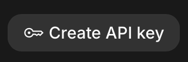
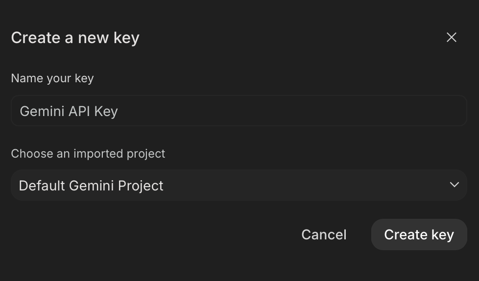

# Google API Key

1. With a signed-in Google account, head over to [Google AI Studio](https://aistudio.google.com/api-keys).

2. Click on `Create API Key` on the top right.

    

3. Click on `Create key` in the pop-up.

    

4. Click on `Copy key` in the next pop-up and **save** it. 

### Next step: [1. Ingestion](../1.%20Ingestion/README.md)