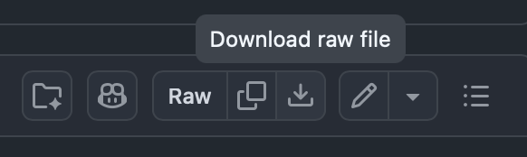

# 1. Ingestion

For this stage, we will implementing `Raw document` -> `Chunks` -> `Embedding model` -> ~~`Vector database`~~ `In-memory "database"`.


---

## 1. Project setup

Run these command to set up the project:

```bash
dotnet new console -n dotnet_rag
cd dotnet_rag
dotnet add package Betalgo.OpenAI
dotnet add package Microsoft.Extensions.Configuration.Json
```

Create a file called `appsettings.Development.json` in the project root directory. Paste this in the file:

```json
{
    "Token": "put-your-google-ai-studio-api-key-here",
    "Endpoint": "https://generativelanguage.googleapis.com/v1beta/openai/",
    "ChatCompletionModel": "gemini-3.5-flash-lite",
    "EmbeddingModel": "gemini-embedding-2"
}
```
Replace the token with what you got in [0. Google Studio API Key](../0.%20Google%20Studio%20API%20Key/README.md).

## 2. Load configuration

Add the following in `Program.cs`:

```csharp
using Microsoft.Extensions.Configuration;
using OpenAI;
using OpenAI.Managers;
using OpenAI.ObjectModels.RequestModels;
using System.Text.RegularExpressions;
```

Add the following to read the settings from `appsettings.Development.json`:

```csharp
var config = new ConfigurationBuilder()
    .SetBasePath(Directory.GetCurrentDirectory())
    .AddJsonFile("appsettings.Development.json",
                 optional: true,
                 reloadOnChange: true)
    .Build();

string? token = config["Token"] ?? throw new Exception("Token not found");
string? endpoint = config["Endpoint"] ?? throw new Exception("Endpoint not found");
string? chatCompletionModel = config["ChatCompletionModel"] ?? throw new Exception("ChatCompletionModel not found");
string? embeddingModel = config["EmbeddingModel"] ?? throw new Exception("EmbeddingModel not found");
```

These represent:

- `Token` - Google AI Studio API Key.
- `Endpoint` - Google Gemini API.
- `ChatCompletionModel` - model used for generating a text response.
- `EmbeddingModel` - model used to convert text into embedding vectors.

If a required value is missing, the program stops immediately.

Add the following to to initialize the API client:

```csharp
var openAiService = new OpenAIService(new OpenAiOptions()
{
    ApiKey = token,
    BaseDomain = endpoint
});
```

---

## 3. Read the source document

Download [`sample_company_handbook.md`](../sample_company_handbook.md) by clicking on the `Download raw file` button on the top right.




 Save the file in your project and add this line in `Program.cs` to read it:

```csharp
string markdown =
    File.ReadAllText("./sample_company_handbook.md");
```

---

## 4. Split the document into chunks

Add the following to split the chunks using regular expression and store them as tuples:

```csharp
var chunks = new List<(string Heading, string Text)>();

var pattern =
    @"(?ms)^###\s+(.+?)\r?\n(.*?)(?=^#{1,3}\s+|\z)";

foreach (Match match in Regex.Matches(markdown, pattern))
{
    string heading = match.Groups[1].Value.Trim();
    string text = match.Groups[2].Value.Trim();

    chunks.Add((heading, text));
}
```

> [!TIP]
> About the regular expression:
>
> - `(.+?)` captures the heading.
> - `(.*?)` captures the text following the heading.
> - The final lookahead stops the chunk when another level 1–3 Markdown heading or the end of the document is encountered.
>
> Here's an example what the result would look like:
> 
> ```text
> Chunk 1
> Heading: Vacation Policy
> Text: Employees receive 20 vacation days per year.
> 
> Chunk 2
> Heading: Remote Work
> Text: Employees may work remotely three days per week.
> 
> Chunk 3
> Heading: Sick Leave
> Text: Employees receive 10 paid sick days per year.
> ```
---

## 5. Create embeddings

The next step converts every chunk into an **embedding**.

An embedding is a numeric vector representing semantic information about text. Texts with similar meanings tend to have vectors that are closer together in the embedding space.

The application creates an in-memory data store and embeds every chunk:

```csharp
var inMemoryDatabase =
    new List<(string Source,
              string Text,
              List<double> Embedding)>();

foreach (var chunk in chunks)
{
    var resp =
        await openAiService.Embeddings.CreateEmbedding(
            new EmbeddingCreateRequest
            {
                Input = chunk.Text,
                Model = embeddingModel
            });

    var chunkEmbedding = resp.Data.First().Embedding;

    inMemoryDatabase.Add(
        (chunk.Heading, chunk.Text, chunkEmbedding));
}
```
---
We've implemented the Ingestion phase.

The `sample_company_handbook.md` will be broken down into chunks. Each chunk will then be embedded and stored in the in-memory "database".

### Next step: [2. Retrieval](../2.%20Retrieval/README.md)